<p align="center">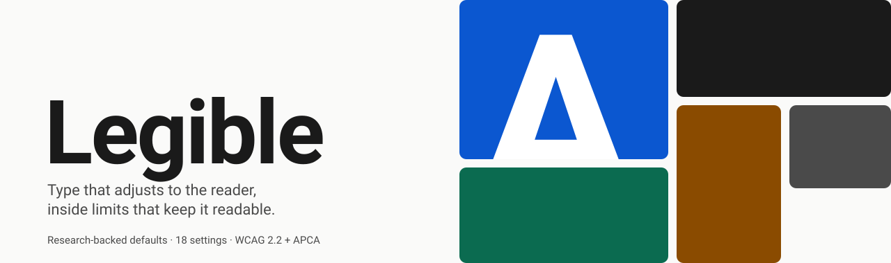</p>

<p align="center">
  <a href="https://github.com/ZPARXMarketing/Legible-DesignSystem/actions/workflows/ci.yml"></a>
  
  
  
</p>

**Legible** is a research-backed design system whose text settings the reader can change, inside limits that keep every combination readable.

Research finds no single font or setting is best for everyone: readers were about 35% faster in their own best font (Wallace et al., 2022). So Legible does three things:

1. Ships **research-backed defaults** that work for most people.
2. Lets each reader **adjust everything** research shows matters: font, size, spacing, line length, theme, contrast.
3. **Clamps every setting** to a safe range and **auto-fixes contrast**, so no combination becomes unreadable.

Everything on this page is generated from the real tokens and the real engine (`npm run visuals`), so the pictures cannot drift from the code.

## Contents

[Themes](#six-themes) · [Legible Reader](#legible-reader) · [Legible Studio](#legible-studio) · [What readers can change](#what-readers-can-change) · [Guardrails](#guardrails) · [Contrast](#contrast-checked-two-ways) · [Architecture](#architecture) · [Type](#type) · [Quick start](#quick-start) · [Use it](#use-it) · [CLI](#cli) · [Components](#components) · [Repo layout](#repo-layout) · [Status and roadmap](#status-and-roadmap)

## Six themes

Light, Sepia, Dark, Dim and two High-contrast themes. Dark themes avoid pure black and white to reduce halation; both High-contrast themes meet 7:1 for text and mark surfaces with borders, not shade. Status colors always carry a symbol (✓ ⚠ ✕) and a word, never hue alone.

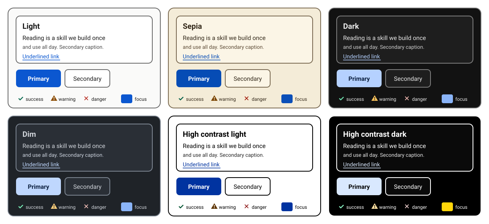

| Theme | Ground | Ink | Notes |
| --- | --- | --- | --- |
| Light | `#fafaf9` | `#1a1a1a` | Default. Light grounds give the best accuracy for most readers. |
| Sepia | `#f4ecd8` | tuned | Warm, popular for long reading. |
| Dark | `#121212` | tuned | No pure black or white. Weight rises to 450. |
| Dim | `#1f2328` | tuned | Softer dark for evenings; targets the Comfortable contrast level. |
| High contrast light | `#ffffff` | `#000000` | 21:1. |
| High contrast dark | `#000000` | `#ffffff` | 21:1, borders on every surface. |

A color-vision mode swaps status colors to the Okabe–Ito family (blue success, orange warning, vermillion danger): set `data-cvd` on any ancestor.

## Legible Reader

`<legible-reader>` is a drop-in web component: one **Aa** button (or **Alt + A**) opens a side panel on desktop and a bottom sheet on phones. Changes apply live to the page behind it, stay inside the safe ranges, and say so when the engine corrects something.

<table>
<tr>
<td width="50%">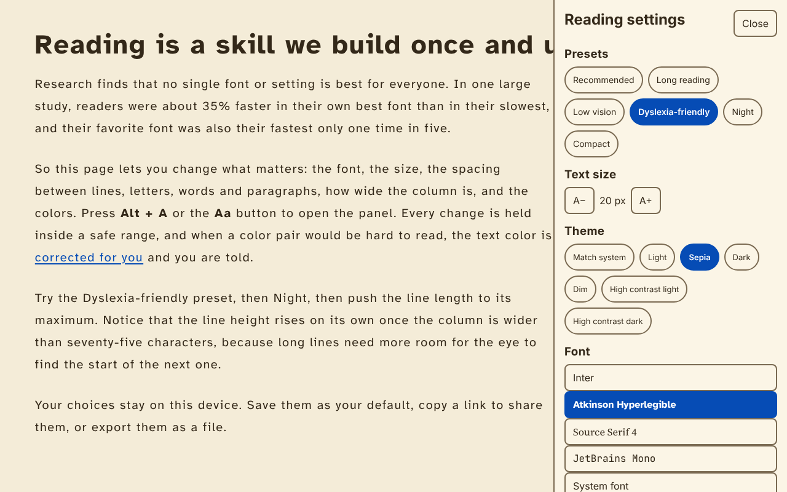</td>
<td width="50%">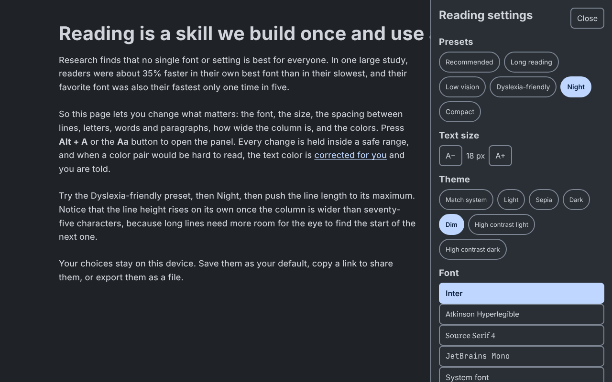</td>
</tr>
<tr>
<td align="center"><sub><b>Dyslexia-friendly</b> preset: Atkinson Hyperlegible, 20px, line height 1.8, letter spacing +0.08em, Sepia</sub></td>
<td align="center"><sub><b>Night</b> preset: Dim theme, weight 450, Comfortable contrast</sub></td>
</tr>
</table>

<p align="center">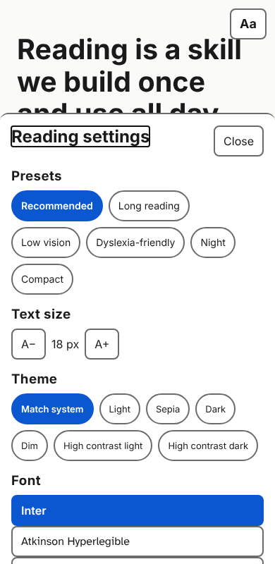<br><sub>On a phone the panel becomes a full-width bottom sheet. Every control is at least 44px.</sub></p>

```html
<link rel="stylesheet" href="dist/tokens.css">
<legible-reader target="article" presets="all" load-fonts></legible-reader>
<script type="module" src="dist/legible-reader.js"></script>
```

- **Presets, theme, font, size, spacing, contrast, color-vision mode, reading ruler, hyphenation, custom colors**; undo (Ctrl/Cmd + Z), reset to recommended.
- **Persistence:** `localStorage` key `legible.prefs.v1`, a share link (`?legible=<base64>`), and export to a `.json` file. Imported and shared values are whitelisted and clamped; a malformed link falls back to defaults and custom colors must be plain hex (no CSS injection).
- **No flash:** paste [`packages/reader/boot.js`](packages/reader/boot.js) inline in `<head>` so the saved theme is set before first paint.
- **OS aware:** `prefers-color-scheme`, `prefers-contrast: more` (starts at Maximum), `prefers-reduced-motion`, forced colors.
- **Contrast correction:** pick Comfortable, Standard or Maximum and the text color is corrected against the live theme background; custom colors are corrected too, with a visible "Adjusted text color for readability." note.
- **Events:** `legible-change` fires with `{ prefs, theme, notes }` for analytics or app state.
- **Live demo:** serve the repo root and open `packages/reader/demo/index.html`. A real-browser test (`npm run smoke`, 20 checks) drives it, including the single-file bundle and the mobile sheet.

## Legible Studio

`legible init` turns one to three brand colors into a complete system: six themes, status and color-vision colors, type scale, spacing, radii, and every export, then proves it passes. Colors are built in OKLCH and the contrast engine moves **lightness only**, so the hue stays the brand's.

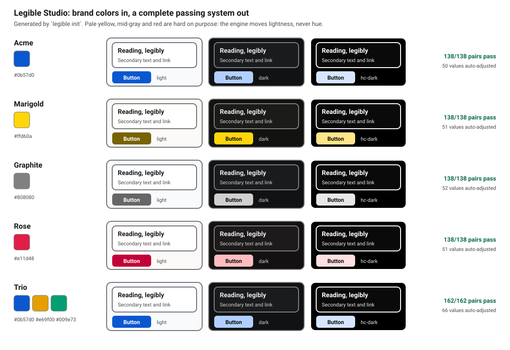

```bash
npx legible init --name Acme --brand "#0B57D0,#E69F00" --type app --out ./acme
# or run `legible init` with no flags for the prompts
```

| Input | Options |
| --- | --- |
| `--brand` | one to three hex colors (primary, then optional `accent-2` and `accent-3`) |
| `--type` | `reading` (18px, ×1.25), `app` (16px, ×1.2), `dashboard` (15px, ×1.2), `marketing` |
| `--radius`, `--spacing` | corner radius and spacing base in px |
| `--sans`, `--serif` | font stacks, validated for unsafe characters |

Output: `tokens/tokens.json`, `legible.config.json`, and `dist/` with CSS, Tailwind, DTCG, Swift, Android and the report card. The generator is tested against pale yellow, pure black, mid-gray, red, near-white and a three-color brand: every pair in every theme passes.

## What readers can change

Eighteen settings, each with a limit. The panel always renders in Recommended styling so it stays usable at extreme settings.

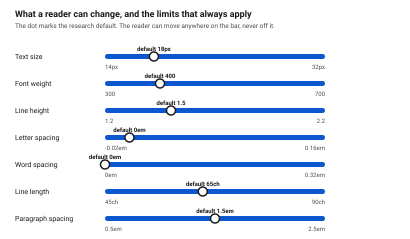

Presets give one-tap starting points. The full list of settings, ranges and the research behind each is in [`docs/reader-settings.md`](docs/reader-settings.md).

| Preset | Font | Size | Line height | Letter spacing | Theme | Contrast |
| --- | --- | --- | --- | --- | --- | --- |
| Recommended | Inter | 18 | 1.5 | 0 | OS | Standard |
| Long reading | Source Serif 4 | 19 | 1.6 | 0 | Light or Sepia | Standard |
| Low vision | Atkinson Hyperlegible | 24 | 1.6 | +0.02 em | High contrast | Maximum |
| Dyslexia-friendly | Atkinson Hyperlegible | 20 | 1.8 | +0.08 em | Sepia | Standard |
| Night | Inter, weight 450 | 18 | 1.6 | +0.01 em | Dim | Comfortable |
| Older readers | Montserrat or EB Garamond | 20 | 1.6 | 0 | Light | Standard |
| Compact | Inter | 14–16 | 1.35 | 0 | OS | Standard |

## Guardrails

Readers get freedom; the engine keeps it safe. `guard()` runs in a fixed order: clamp each value, raise weight for small text and dark themes, raise line height on long lines, refuse justified text without hyphenation. It returns the safe settings plus a note for every change, so the UI can say "Adjusted for readability."

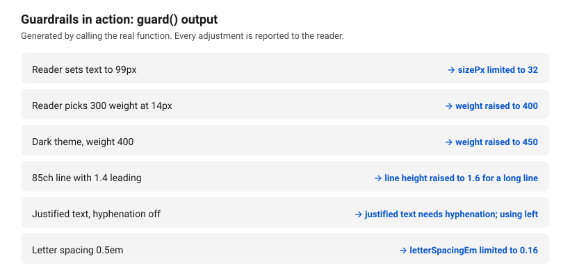

## Contrast, checked two ways

A pair passes only if it meets **both** the WCAG 2 ratio and the APCA Lc for its level. The two measure differently, and light text on a dark ground scores a lower Lc than the same ratio on a light ground, which is why a WCAG-only check lets dim dark themes slip through.

| Level | WCAG 2 | APCA | Used for |
| --- | --- | --- | --- |
| Comfortable | 4.5:1 | Lc 75 | Secondary text, links, status; body text in Dim (Night) |
| Standard | 7:1 | Lc 90 | Body text (default) |
| Maximum | 12:1 | Lc 105 | Body text in High-contrast themes |
| Non-text | 3:1 | – | Borders, focus rings, icons |

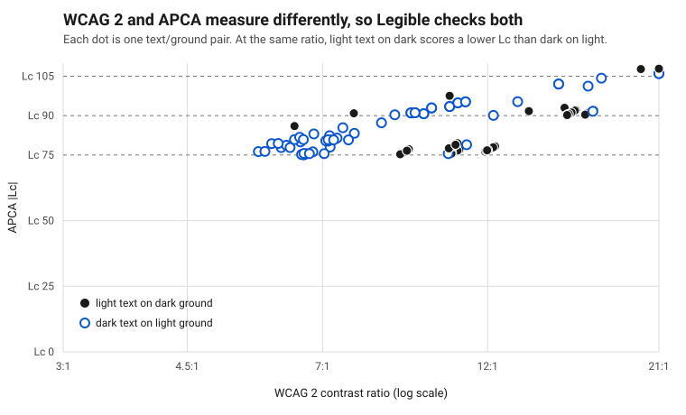

Every text color on both grounds in every theme, as the build sees it (`npm run check`; the full table is `dist/report.html`):

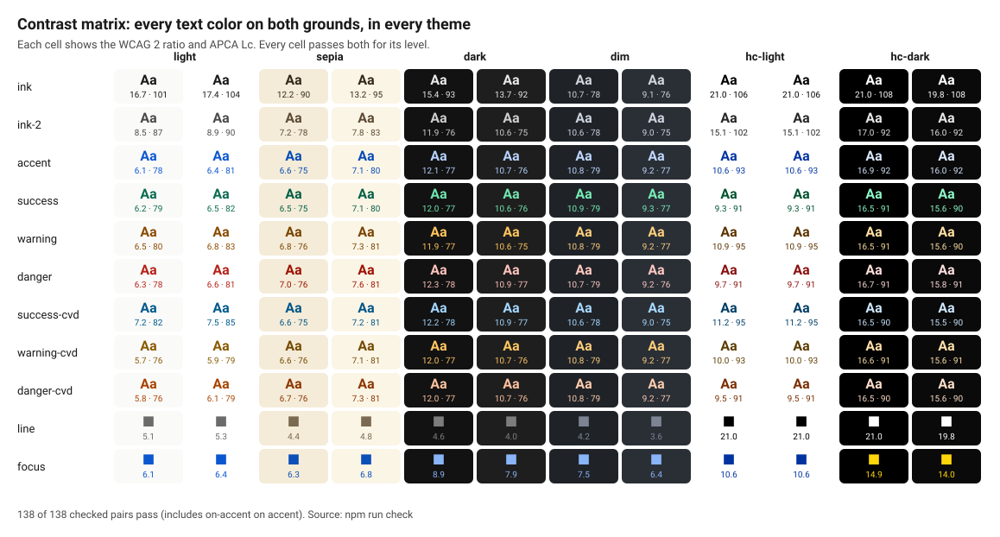

The engine fixes failures itself. `fixContrast()` shifts only the **lightness** in OKLCH, so hue and chroma stay on brand, and returns both colors in case the ground had to move. `legible fix` applied it to the starting palette: dark and Dim accents and status colors became lighter pastels because APCA demands it.

## Architecture

Each layer can only override the one below it. Guardrails run last, every time. Brands can pick defaults inside the ranges but never widen them.

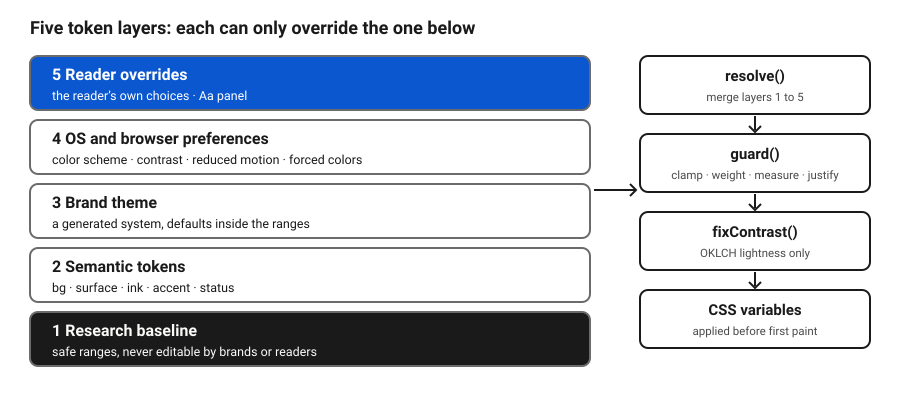

Tokens are authored in one file, [`tokens/tokens.json`](tokens/tokens.json), and exported to every target.

## Type

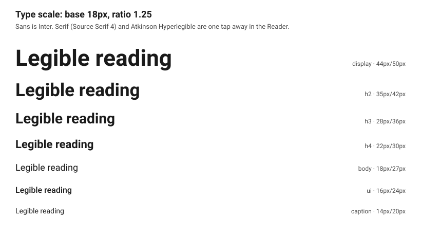

- Default family Inter at 18px, line height 1.5, 65 character measure, 1.5em between paragraphs.
- Alternatives in the Reader: Source Serif 4 for long reading, Atkinson Hyperlegible for low vision and dyslexia, JetBrains Mono for code.
- `font-size-adjust: from-font` keeps "18px" looking the same in every family.
- Every interactive target is at least 44px; text spacing survives WCAG 1.4.12 and 200% zoom.

## Quick start

```bash
git clone https://github.com/ZPARXMarketing/Legible-DesignSystem.git
cd Legible-DesignSystem
npm test           # unit tests for the engine and exporters
npm run build      # tokens.css, Tailwind preset, DTCG, Swift, Android, report card
npm run bundle     # dist/legible-reader.js: one file, no dependencies
npm run check      # contrast matrix, exits 1 on any failing pair
npm run visuals    # regenerate every image in docs/img
```

No dependencies to install; it needs Node 20 or later.

## Use it

**CSS.** Load the tokens, then the component stylesheet, and set a theme on any element:

```html
<link rel="stylesheet" href="dist/tokens.css">
<link rel="stylesheet" href="packages/components/bundle.css">
<html data-theme="sepia">
```

**Tailwind.** `dist/tailwind.preset.js` maps every token to its CSS variable:

```js
import legible from './dist/tailwind.preset.js';
export default { presets: [legible] };   // then: class="bg-bg text-ink border-line"
```

**Engine.** Resolve reader choices through the guardrails and fix a custom color pair:

```js
import { resolve, fixContrast, passes } from './packages/core/src/index.js';

const settings = resolve({ brand: { sizePx: 18 }, user: { sizePx: 22, measureCh: 85 } });
// { sizePx: 22, lineHeight: 1.6, measureCh: 85, notes: ['line height raised to 1.6 for a long line'], ... }

const { text, bg } = fixContrast('#8ab4f8', '#ffffff', 'standard');
passes(text, bg, 'standard'); // true
```

## CLI

```
legible init --name Acme --brand "#0B57D0"   generate a new system from brand colors
legible build                   write every export and dist/report.html
legible check                   run the contrast matrix (WCAG 2.2 + APCA)
legible fix                     auto-fix failing token values (lightness only)
                                add --tokens <file> and --out <dir> to any command
legible export --target ios     css | tailwind | dtcg | ios | android
```

| Output | File |
| --- | --- |
| CSS variables | `dist/tokens.css` |
| Tailwind preset | `dist/tailwind.preset.js` |
| DTCG tokens (per theme) | `dist/tokens.dtcg.json` |
| iOS | `dist/ios/LegibleTokens.swift` |
| Android | `dist/android/legible_tokens.xml` |
| Report card | `dist/report.html` |
| Reader web component | `dist/legible-reader.js` |

## Components

Bundled as `window.Legible` (React 18) in [`packages/components`](packages/components), each with a README and a live preview.

| Component | What it is |
| --- | --- |
| Button | Primary, secondary and quiet; 44px targets; solid focus ring |
| Link | Always underlined, in `accent` |
| Alert | Info, success, warning, danger; symbol plus word, never color alone |
| Prose | Research-default reading text, sans or serif |
| Heading | h1 to h4 from the type scale |
| Input | Always-visible label, hint, and error with ✕ and the word "Error" |
| Card | Bordered container, no shadow |
| Table | Column headers, tabular figures, line-divided rows |
| Reader | The reader settings panel with live page and `guard()` applied |

## Repo layout

```
tokens/tokens.json          source of truth for every token
packages/core               OKLCH, WCAG, APCA, guard(), resolve(), fixContrast() + tests
packages/exporters          css, tailwind, dtcg, swift, android + tests
packages/cli                legible init | build | check | fix | export, report card
packages/studio             brand colors -> complete token system (generateTokens)
packages/reader             <legible-reader>, pure preference logic + tests, boot.js, demo
packages/components         React bundle, stylesheet, types, previews
scripts/make-visuals.mjs    generates docs/img from the tokens and the engine
scripts/smoke-reader.py     real-browser test of the Reader (Playwright)
dist/                       generated outputs (committed; CI fails if stale)
docs/                       reader settings, Studio plan, original spec
```

## Status and roadmap

**Working today:** the contrast and guardrail engine, six themes plus color-vision tokens, all exporters and the report card, `legible init`, the `<legible-reader>` web component, nine components, 49 unit tests, a 20-check browser test, and CI that fails on stale outputs.

**Next:**

1. "Find my best font" calibration (six timed passages, words per minute) inside the Reader.
2. Self-hosted WOFF2 fonts with size normalization.
3. Figma (Tokens Studio) exporter.
4. WCAG 1.4.12 text-spacing and 200% / 400% zoom tests, plus axe-core, in CI.
5. Studio web app and a docs site generated per brand.
6. Remaining components for the generated React package (Text, ReaderPanel wrapper).

The full original specification is in [`docs/spec.md`](docs/spec.md).

## License

[MIT](LICENSE)
